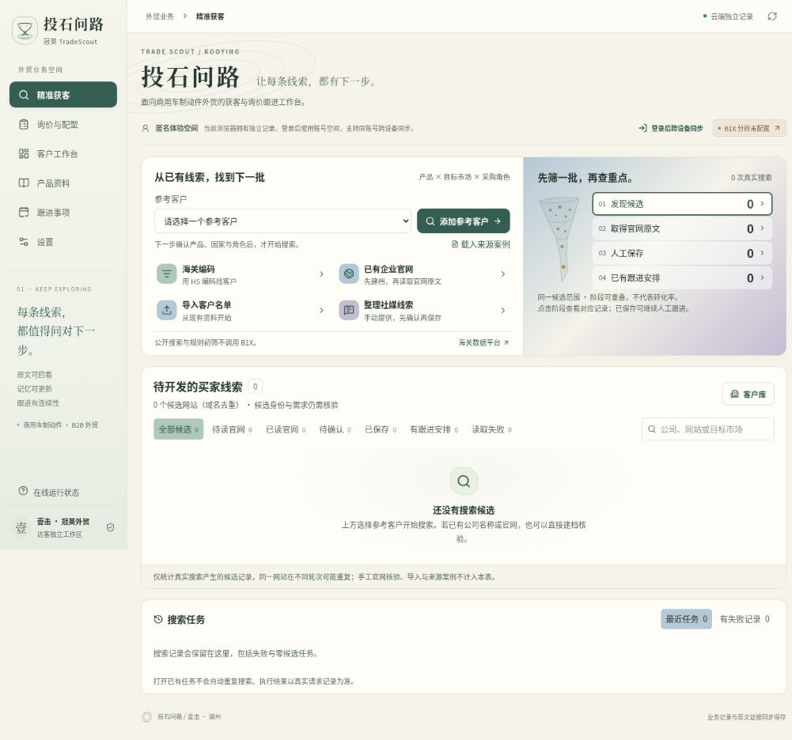
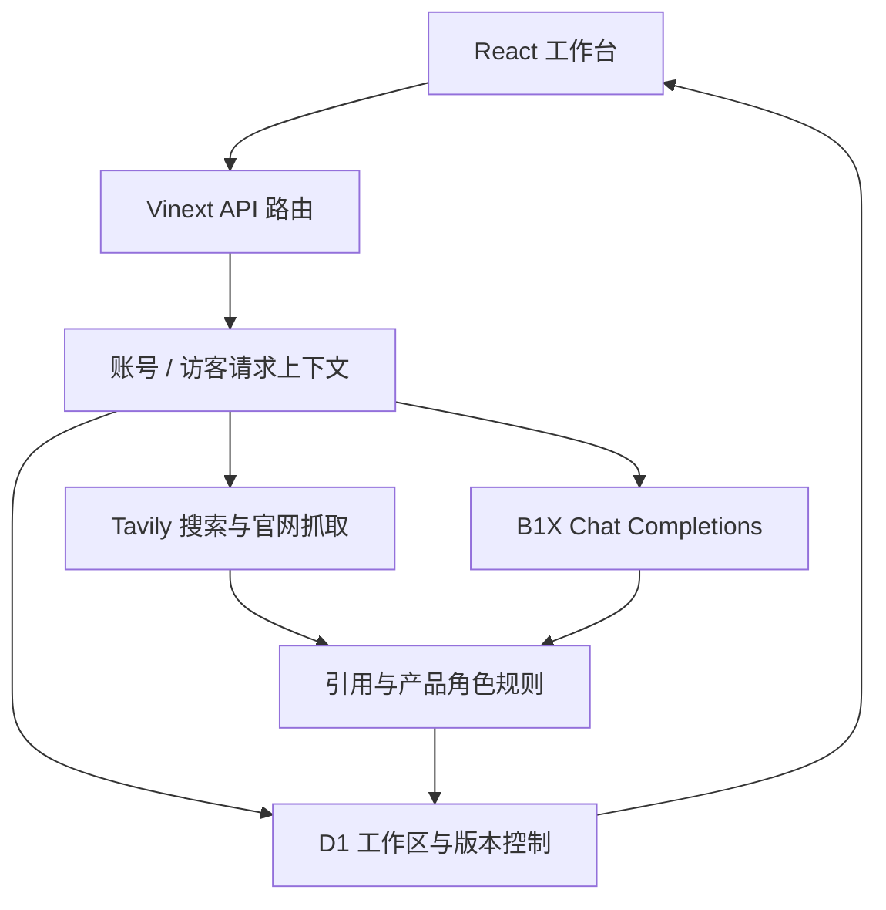

# 投石问路 / 冠英 TradeScout

[](https://github.com/18937607468-blip/yiji-tradescout/actions/workflows/ci.yml)

**把公开企业线索变成有来源、可确认、可持续跟进的商用车制动件客户记录。**

壹击队 · INTERCITY HACK 湖州站 · AI+GTM。保留当前莫奈水色界面、全部业务路由、Vinext/React 与 Cloudflare D1 架构。

[在线演示](https://guanying-tradescout-huzhou-2026.woolly-joy-5493.chatgpt.site/) · [四项技术亮点与测试](docs/TECHNICAL_HIGHLIGHTS.md) · [90 秒演示](docs/DEMO.md) · [本次验收记录](docs/PUBLISH_VERIFICATION.md)

> 来源基线：2026-11-22 核对的 Sites 第 23 版，已部署提交 `78eca887d3c8b41b3cb24e0d9ad70f103e47ee11`。本仓库在该完整真实源码上做发布修复；没有使用 Windows 旧包替换。在线演示仍是基线，发布修复尚未重新部署到线上。详见 [来源与差异](docs/SOURCE_PROVENANCE.md)。



截图来自本次本地实际运行页面。空列表如实显示；没有用生成图片或虚构获客数字。

## 四项实现

| 技术点 | 实际行为 | 主要入口 |
| --- | --- | --- |
| 证据约束 AI 客户研究 | 抓取官网原文、URL、时间；核对引用、编号体系与企业角色；推断待人工复核，失败不补造成功结果 | `lib/platform/research.mjs`、`web.mjs`、`screening.mjs` |
| 行业分层精准获客 | 产品/HS/市场/角色生成查询，Tavily 搜索、去重、官网核验、人工确认保存；未配置独立 Key 则不外呼 | `lib/platform/buyer-discovery.mjs`、`company-website.mjs` |
| 可确认客户记忆 | 原话与发生时间→原值/新值 diff→确认或取消；旧消息拒绝覆盖、重复幂等、询盘隔离、保留历史 | `lib/platform/domain.mjs`、`components/platform/CommunicationChanges.tsx` |
| 客户跟进闭环 | 客户→证据→待补证→负责人/日期/动作→沟通→再研究；服务端保存与 revision 冲突检查 | `lib/platform/store.mjs`、`inquiries.mjs`、`components/platform/TradeScoutPlatform.tsx` |

这些是本项目的实现重点，不宣称算法首创、商业效果已验证或所有输出都能自动核实。通用客户记忆目前由业务员依据原文提出；AI 询价字段提取是另一条独立、待人工确认的流程。

## 实际架构



- React 19 / TypeScript / Vinext / Vite 8；生产构建为 Cloudflare Worker，保留 Next App Router 风格路由。
- D1 的 `workspace_state` 按 `owner_id` 保存 JSON 工作区，以版本比较后写入防止覆盖。模型、搜索配置分别按账号 AES-GCM 加密；密钥和业务数据库不会随源码发布。
- `lib/platform/api.ts` 创建账号或随机访客上下文。托管登录由 Sites 提供；本地开发使用 starter 的回环地址模拟登录。不要将原样 Worker 裸露在不可信身份头的任意网关后。
- 当前演示工作区有 1.8 MB 上限；这是比赛 MVP，不是大规模 CRM 数据库。

## 复现与本地启动

使用 Node.js **24 LTS** 与 npm。锁文件是 `package-lock.json`，无需 Python、PostgreSQL 或真实 API Key 即可完成检查。

```bash
npm ci --no-audit --no-fund
npm run typecheck
npm test
npm run build
npm run db:migrate:local
npm run dev
```

默认开发地址由命令输出，通常为 `http://localhost:5173`。首次启动先构建和迁移，数据库只落在忽略的 `.wrangler/state`。迁移脚本固定 `--local`，不触碰线上数据。若刚克隆后 `typecheck` 没有 `next-env.d.ts`，TypeScript 配置仍能完成；构建会生成该忽略文件。

可选密钥功能：将 `.env.example` 复制为 `.dev.vars`，自行生成 32 字节 base64url `APP_DATA_KEY`，然后重启开发服务器。可用 `node -e "console.log(require('node:crypto').randomBytes(32).toString('base64url'))"` 在自己终端生成；不要提交生成值。访问开发服务器的 `/signin-with-chatgpt?return_to=/platform` 使用本地测试身份，再在设置中配置自己的服务。

此线上实现保留**按账号加密的服务端配置**，不读取共享的 `B1X_API_KEY` 环境变量；也不使用任何 `VITE_`/`NEXT_PUBLIC_` 密钥。前端密码输入仅通过本站接口提交，读取接口不回传密钥。

| 外部服务 | 固定配置 / 条件 | 本次验证级别 |
| --- | --- | --- |
| B1X | `https://token.b1x.work/v1`；`deepseek-v4.1-flash-1017`；`client.chat.completions.create()` | mock 协议与异常测试通过；真实 Key 待验证 |
| Tavily | 每个账号独立搜索 Key；与 B1X 不通用；未配置不请求 | mock 搜索/401/429/空结果/网络故障测试通过；真实 Key 待验证 |
| 公开官网 | 有限页面、超时、重定向检查、原文保存 | mock 全链路通过；页面实际可达性随站点变化 |
| Brave | 没有实现，不会调用 | 不宣称已接入 |

不设置每日 4 次模型限制。模型请求有超时、单次输出 token 限制和持久调用记录；不自动重复收费请求。搜索另保留最多 6 轮/天、每轮最多 2 个查询、核验最多 3 家的预算；不会把搜索预算说成模型限制。

## 检查与边界

```bash
npm run check:secrets -- --history
npm test
npm run typecheck
npm run build
```

本次本地共 **121 项测试通过**，类型检查、生产构建及本地数据库迁移通过。网络测试使用合成 fixture 和明确 mock；没有把 mock 当作线上服务联调。CI 配置见 `.github/workflows/ci.yml`，GitHub Actions 的真实状态以仓库运行结果为准。

- 未配置模型：官网原文可独立保存，模型分析明确报错。
- 未配置搜索：保留查询输入，支持 CSV 与用户提供官网路径。
- 数量 50→200 是询价条件更新，不自动成为订单或成交。
- `material-cost.mjs` 仅计算有单位与来源的材料参考；旧条件变动标记需重算，不生成完整正式报价。
- 官网文字为不可信数据；原文引用匹配不能证明摘要语义、页面真实性或实际采购意向。角色/产品规则保守过滤，仍需人工核对。
- 不自动外发邮件、消息，不连接私有海关数据、不绕过登录、不给未验证买家承诺库存或报价。

## 目录与来源

`app/api/platform/`：实际后端路由；`components/platform/`：业务界面；`lib/platform/`：规则、模型与持久化；`drizzle/`：完整迁移；`scripts/*.test.mjs`：可重复测试。

保留 `LICENSE` 中的 **Mendable AI / MIT** 版权。早期项目来源于 `firecrawl/fire-enrich`，托管适配沿用 Sites Vinext starter；第三方来源见 `THIRD_PARTY_NOTICES`，不将全部代码宣称为原创。公开来源企业样例在代码和界面注明用途，真实客户数据、API Key、运行日志及导出不入仓。
