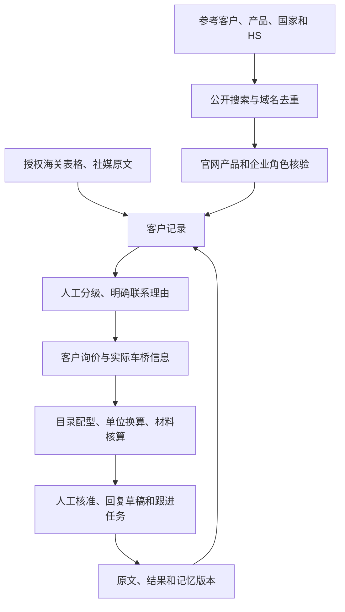
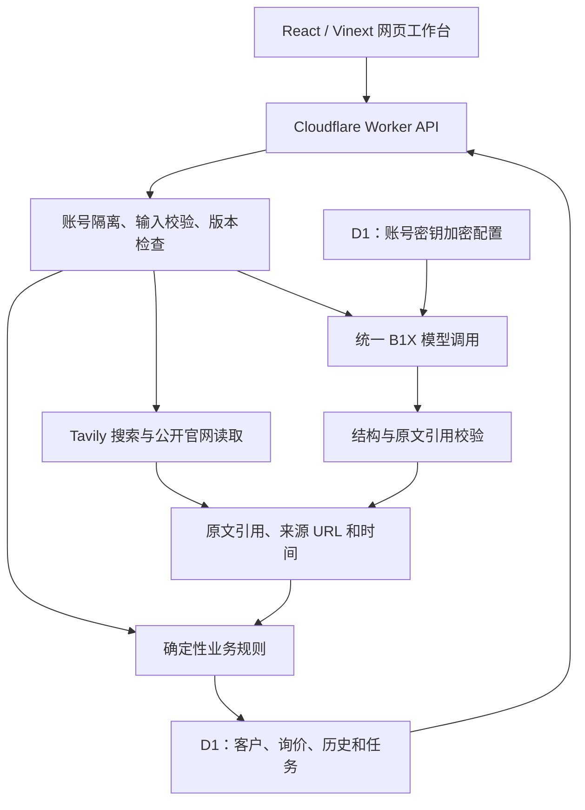

> 历史工程资料，继承自线上 v23。本文的历史验收未在本轮全部重新执行；本次发布状态与差异请看 [PUBLISH_VERIFICATION.md](PUBLISH_VERIFICATION.md) 和 [SOURCE_PROVENANCE.md](SOURCE_PROVENANCE.md)。

# 冠英 TradeScout：实际架构、设计判断与演示边界

更新：2026-11-21，北京时间。本文以实际源代码和已完成的运行验收为依据，不把研究设想算作已上线功能。

## 架构判断

主干适合比赛 MVP：先低成本发现候选，再对少量重点公司核验；客户来了以后，用来源约束、配型规则、材料公式和版本记忆承接。最重要的设计是把“模型读资料”和“程序执行业务条件”分开。

主线应保持为 **找到候选 → 确认公司 → 核对产品和采购角色 → 联系与跟进 → 接住询价**。财报、客户关注点和传播内容是辅助功能，不应成为首页的并列主任务。

## 业务架构

公司名称与官网的对应关系、产品相关性、采购角色、当前意向是四个不同判断。HS 只能作为品类检索线索；相同件号也不自动证明适配。官网上明确写出的联系方式，不等于采购负责人的联系方式。

公司名补官网已实现独立的查询、原文核验和人工确认流程。2026-11-21 晚间真实验收遇到 Tavily 限流，搜索失败被准确保存。补充了“用户提供官网 → 直接读取原文 → 人工确认归属”的备用路径；该路径不调用搜索，也不会将失败记录改成成功。稳定搜索配额仍是明天演示和生产试用需要解决的外部依赖。

## 技术架构

### 模型和规则分别做什么

| 模块 | 实际执行方式 | 关键控制 |
| --- | --- | --- |
| 新买家搜索 | Tavily 公开搜索；服务端读取官网 | 保存真实查询、状态及原文；摘要只用于初筛 |
| 官网产品与角色核验 | 原文规则和可选 B1X 深研 | 产品证据与企业自身买家角色分开；保持未知项 |
| 询价文字整理 | B1X 提取字段 | 引用原话，人工采用；不由模型生成件号和金额 |
| 财报文字整理 | B1X 提取；规则计算指标 | 只处理公开或已授权文字；不判断客户一定能付款 |
| 配型 | 目录和条件规则 | 年份、制动器、编号体系、尺寸及来源逐项比较 |
| 材料核算 | 确定性数值计算 | 原始单位留存、服务端重算、修改条件使旧记录过期 |
| 客户记忆 | D1 持久化和人工差异确认 | 保留旧值、新值及时间；旧消息不能覆盖新修正 |
| 客户关怀与承诺 | 原文规则、可编辑草稿和依据校验 | 不自动发送；交期、供货和价格需要实际依据 |

当前请求的模型标识为 `deepseek-v4.1-flash-1017`，接口为 `https://token.b1x.work/v1`。OpenAI SDK 在这里是兼容协议客户端，实际请求发给 B1X。应用不设置模型每日调用次数上限；保留单次请求超时、输出长度约束及提供方实际额度限制。实际返回模型、请求 ID、tokens 和耗时单独记录。

**验收状态必须分开：**接口代码、模拟异常测试、真实请求成功、业务结果正确是四个层次。本轮匿名验收没有获得账号中的 B1X Key，不能把规则配型或公式计算写成真实模型已验证。

## 材料核算的准确边界

用户提供的公式：

`外弧 × 宽度 × (厚度1 + 厚度2) / 2 × 1.15 × 2.2 / 1000000 × 材料售价`

标准口径为长度 mm、密度 g/cm³、材料价格为原币种/kg。1.15 和 2.2 为明确展示、可修改的核算假设。长度支持 mm/cm/m/in，材料计价支持 kg/g/公吨/lb，密度支持 g/cm³/kg/m³。切换显示单位保留原始值，不自动换汇。

实际验收样例：220 × 180 × (17.5 + 10.5) / 2 × 1.15 × 2.2 / 1,000,000 × 20 = **28.05264 CNY/片**；250 片的材料参考为 **7,013.16 CNY**。示例材料价 20 CNY/kg 是测试输入，不是企业正式报价。

- `STD / 1+ / 2+` 保留为规格代号，不解释为毫米。
- 每套片数未知时不计算整单总额。
- 修改询价数量或条件后，旧核算留在历史中并标记需重算。
- 当前公式没有自动包含工艺、附件、包装、运费、税费、利润或贸易条款。

## 现在的技术亮点

1. **先筛再深查。**先使用检索与规则，保留少量重点客户再调用模型；不能将有限批次称为已验证的海量获客能力。
2. **每个判断可以回查。**结构化字段绑定 `sourceId / quote`、URL 和时间。引用能证明内容来自哪里，不能保证来源自身正确。
3. **条件变化会传播到结果。**询价、报价参考、核算和承诺与版本绑定，避免客户改了需求后继续发送旧结论。
4. **失去一个客户，也能留下有效信息。**沟通和未成交原因可保留，用于人工调整下一轮筛选；当前没有自动学习或用单个客户结论推断整个国家市场。

这些是代码已实现的机制。MemEdge、D²SR、GraphRAG、向量库和图数据库 SDK 尚未集成；可以说明借鉴的思想，不能将其画成已部署服务。

## 数据与交付边界

| 项目 | 当前能力 | 尚缺什么 |
| --- | --- | --- |
| 海关 | 已授权 CSV/TSV 导入、HS 与货描筛选；转单云后台外链 | 海关平台 API 和自动下载交易数据库 |
| 国内外社媒 | 原文粘贴、截图存证和人工校对文字 | 私信同步、自动回复和图片 OCR |
| 联系方式 | 官网明确公开的邮箱、电话和 WhatsApp 入口 | 已验证采购负责人、邮箱可投递性和实际回复 |
| 配型资料 | 5 条冠英目录记录、3 条 BPW 原厂参考 | 完整目录、车桥关系、企业试验报告 |
| 整单报价 | 单规格材料核算、严格条件下历史价格参考 | 多行询盘整单处理和完整销售定价 |
| 客户记忆 | 原话、字段差异、人工确认与版本时间 | 科研记忆引擎和自动优化策略 |
| 协作 | D1 按账号保存，同账号跨设备 | 多人团队角色、组织权限、共享工作区 |

转单云会话只在登录过的同一浏览器中复用。公开源码和网页不包含比赛账号或密码；会话过期仍由该平台处理登录。

当前 D1 将一个工作区保存为 JSON 并采用版本比较写入，适合本次演示与小规模试用。工作区存在容量门槛；生产化应拆分客户、证据、消息、询价和任务表，再配置索引、队列及权限，不能直接承诺十人团队海量并发。

## 我会优先解决的逻辑缺口

1. 公司名补官网入口已经补齐；现在要稳定搜索服务配额，并保留手工网址取证路径，避免外部限流阻断全部工作。
2. 让销售记录候选是否合格、为什么不合格、是否联系及回复结果。精度、获客成本和转化提升只能由这些结果测量。
3. 用企业提供的 10 个好客户和 5 个误判客户验证筛选，再补最常用的 10–20 个 SKU 及真实车桥关系。
4. 用 3–5 个真实历史询盘验证字段提取、询问次数和核价耗时；不以演示样例代替商业验证。

## 主要实现位置

- 搜索与官网证据：`lib/platform/buyer-discovery.mjs`、`web.mjs`、`screening.mjs`
- 模型调用与真实日志：`model-usage.mjs`、`model-config.mjs`、`research.mjs`
- 配型与询价：`fitment.mjs`、`inquiries.mjs`、`inquiry-extract.mjs`
- 材料公式与转换：`material-cost.mjs`
- 记忆差异及客户操作：`domain.mjs`
- 承诺核验：`assurance.mjs`
- 账号、持久化和并发：`api.ts`、`store.mjs`、`context.mjs`

详细测试和发布结果见 `acceptance.md`。架构文档中的“已实现”只描述实际代码；真实模型与客户业务结果需各自验收。
